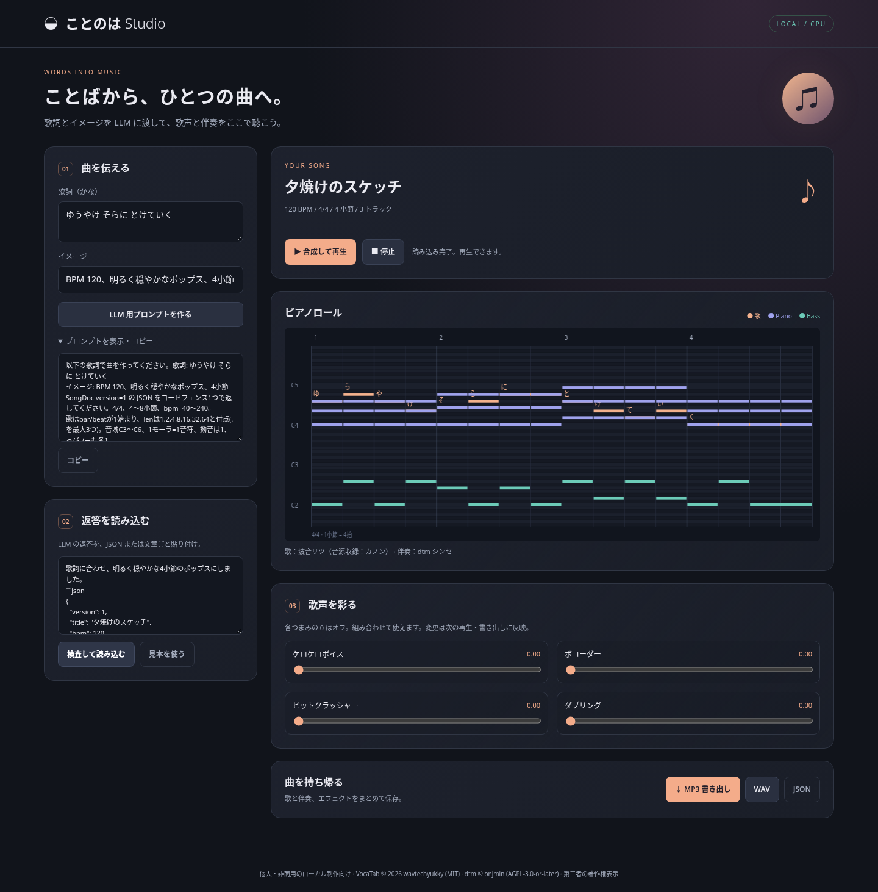

# ことのは Studio / browser-dtm（非公開・impl/codex）

歌詞とイメージを LLM に貼り付け、返答の SongDoc JSON を読み込むローカル DTM。VocaTab の日本語歌声を CPU/WASM で合成し、dtm 2.1.38 の MML パーサと軽量シンセで2パート以上の伴奏を作る。同じ音声バッファをブラウザ再生と書き出しに使う。



## 起動

必要: Node.js 22 以上（検証: 24.22.1）、npm、ffmpeg（libmp3lame）、Chrome。Linux の自動検証は `/usr/bin/google-chrome` を使う。

```bash
npm ci --no-audit --no-fund
export VOCATAB_DIR=/workspace/dtm-research/vocatab
npm run build
npm start
```

`http://127.0.0.1:5200` を開く。codex の許可ポートは5200〜5299。`PORT=5202 npm start` などで変更できる。サーバーは loopback のみに bind する。終了は Ctrl+C。

このマシンの VocaTab clone はそのまま読み取り専用で使う。他の環境で取得する場合:

```bash
mkdir -p vendor
git clone https://github.com/wavtechyukky/vocatab.git vendor/vocatab
git -C vendor/vocatab checkout 2d2a48b
export VOCATAB_DIR="$PWD/vendor/vocatab"
npm run build
npm start
```

検証した上流 revision は `2d2a48b`。clone には `web_index.json`、`voicebanks/leapsinger_ja_3singer/` の ONNX・JSON・話者ベクトルと、`vocoders/nhvsing_v3_2_1/vocoder.onnx` が必要。モデルが Git LFS ポインタの場合は、その clone 内で `git lfs pull` により実体を取得する。モデルの条件を上流 README / THIRD_PARTY_NOTICES で確認してから個人・非商用で利用する。**モデル・ボコーダ・音源は commit・再配布しない。** 既存の共有 clone には変更を加えない。

dtm は npm の `@onjmin/dtm@2.1.38` を lockfile に固定済み。上流へのパッチはない。ONNX Runtime も npm の1.20.1からローカル配信し、WebGPU を要求しない。SoundFont は使わず、dtm の内蔵シンセで Piano（減衰三角波）/Bass（正弦波）/Pad（鋸歯状波）を描く。CDN・LLM API への接続は不要。

## 曲を作る・保存する

1. 「歌詞」「イメージ」を入力し「LLM 用プロンプトを作る」→表示欄からコピーする。
2. 好きな LLM に自分で貼り付ける。アプリは外部 LLM に送信しない。
3. 返答をコードフェンスや説明文ごと貼り、「検査して読み込む」。失敗時は表示された修正依頼を LLM に戻す。
4. 「合成して再生」。最初の合成時は約68MBのローカルモデルを読む。
5. 歌声エフェクトを調整し、「MP3 書き出し」。WAV / SongDoc JSON も保存可能。MP3/WAV は `out/song.*` にも残る。同名の次の書き出しで上書きされる。

実際の LLM を使わない確認には「見本を使う」。自作の [見本返答](fixtures/llm-reply.txt) と [SongDoc](fixtures/song.json) は「ゆうやけ そらに とけていく」、BPM120、4小節、波音リツ＋Piano/Bass。

エフェクトは歌トラックの `effects` に保存する。`kerokero` は音符 MIDI 高さへの F0 平坦化（音響合成前）、`vocoder` は16帯域の音声包絡＋音符追従鋸歯状キャリア、`bitcrusher` は量子化＋サンプル保持、`doubling` は変調した約18msディレイ。各0〜1、0は完全バイパス、複数同時に使える。再生・書き出しで同じ処理を使う。

## SongDoc と対応範囲

完全な例は `fixtures/song.json`。正本は JSON、歌詞割り当てと変換は `src/song.mjs` に集約する。

- `version:1`、`bpm:40..240`、`beatsPerBar:4`、`bars:1..32`。推奨4〜8小節。歌1トラック、総トラック数8以下。
- 歌音符: `bar` / `beat` は1始まり。`beat` は小数可、内部は TPQ480 に丸める。`len` は `1,2,4,8,16,32,64` と最大3つの付点（例 `8.` = 360 ticks、四分音符 = 480 ticks）。`pitch` は `G4` / `Bb3` / `C#4`。歌の範囲 C3〜C6。音符は時刻順で重ならない。
- `lyric` はひらがな1モーラ。拗音 `きゃ` は1つ、`っ` / `ん` / `ー` も各1つ。`set_lyrics` は空白・句読点を除去し、過不足を事実として返す。過不足時は曲を変更しない。
- 伴奏: `kind:"inst"`、`program:"piano"|"bass"|"pad"`、`mml`。厳格な部分集合: `o0..8`、`l4` 等の音価、`v0..127`、曲と同じ `t`、`cdefgab`、`r`、半音 `+/#/-`、`<>`、和音 `'ceg'`、音符の音価・付点。小節線・コメント・繰り返し・マクロ・音源URL・`@n` 宣言はパート内では未対応。アプリが `@n tBPM ...;` を組み立てる。
- MML 検査は未対応文字の位置、音符数、残りの192分音符ステップ数、曲末超過を返す。初期値はホストが `o4 l4 v100` を明示する。MML の付点は dtm 2.1.38 の仕様（1つごとにステップ数を1.5倍して四捨五入）に従い、SongDoc の歌音価の複付点とは異なる。ブラウザでは dtm の実パース結果と共通変換結果の一致も検査する。
- `volume:0..1`、歌の `singer:"ritsu"|"oniku"|"natsume"`。見本以外の歌い手については上流の出力音声の条件も確認する。

歌の句を VocaTab の `start_sec` に配置し、負時刻の部分は曲頭で切る。伴奏は dtm の48ステップ/拍で OfflineAudioContext に描画し、歌と1本のバッファへ混ぜる。再生スケジューラによるトラック間の開始差は発生しない。合成の待ち時間と再生の同期誤差は別の値。見本では予定開始差0ms、有音開始差約6.33ms。

## MCP（stdio）

```bash
VOCATAB_DIR=/workspace/dtm-research/vocatab npm run build
VOCATAB_DIR=/workspace/dtm-research/vocatab node scripts/mcp.mjs
```

MCP クライアント設定例（パスは自分の checkout に合わせる）:

```json
{"mcpServers":{"browser-dtm":{"command":"node","args":["/workspace/browser-dtm-wt/codex/scripts/mcp.mjs"],"env":{"VOCATAB_DIR":"/workspace/dtm-research/vocatab"}}}}
```

`get_song`, `new_song`, `set_chords`, `set_track_notes`, `set_lyrics`, `set_track_mml`, `set_mix`, `render`, `export`, `finish` を提供。`src/api.mjs` の同じ定義をプロンプトとブラウザでも使う。道具はエラー・音符数・過不足等の事実のみを返す。`export` の既定は MP3。描画が必要になると専用の Chrome とローカル5201番サーバーを起動し、stdio終了時に自分のプロセスだけ閉じる。出力は `out/mcp-song.mp3` / `.wav` / `.json`。Chrome の実行ファイル位置は現状 `/usr/bin/google-chrome` 固定。

## 検証

```bash
npm run build
npm test
npm run test:browser
npm run verify:audio
npm run test:mcp
```

ブラウザ検証は5200、MCP検証は5201を使うため、そのポートの自分の開発サーバーは先に終了する。検証スクリプトは起動した Chrome とサーバーを最後に終了する。

`test:browser` は貼り戻し成功/失敗、ピアノロール、CPU歌声合成、実 AudioContext destination への曲全体の再生、MP3とステム出力、4種×強度0/1、エフェクトの保存を確認する。`verify:audio` は ffmpeg で実際のMP3/WAVをデコードし、各小節の RMS/ピーク・無音・クリップ・頭の差・エフェクト差分を判定する。MCP検証は stdio の道具列から実際に MP3 を作る。音声はすべて gitignore 済み `out/`、数値と小さなスクリーンショットだけ `docs/evidence/` に置く。

既知の範囲: 歌1トラック、4/4・固定テンポ、日本語ひらがな、ピアノロールは表示のみ。ドラム・SoundFont・直接LLM API接続は未実装。見本以外の全歌詞・歌い手の品質を保証する検査ではない。MCP はセッション内メモリに SongDoc を持ち、`export(format:"json")` で保存できる。

[SPEC.md](SPEC.md) が指示書の正本。[REPORT.md](REPORT.md) に受け入れ結果。[NOTICE.md](NOTICE.md) / [LICENSE-POLICY.md](LICENSE-POLICY.md) / [LICENSE](LICENSE) に著作権と利用条件。**非公開を維持し、モデル・生成曲を配布/投稿しない。**
